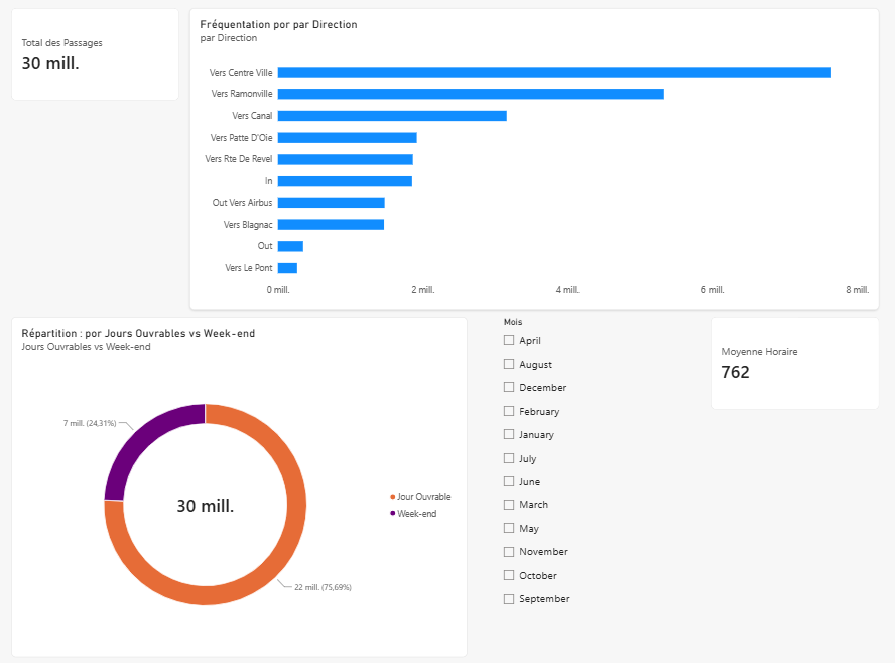

#  Toulouse Bike Traffic & Mobility Dashboard

Ce projet présente un pipeline complet d'analyse de données pour visualiser et comprendre les flux de circulation cycliste à Toulouse. L'ensemble des données est structuré selon un **modèle en étoile (Star Schema)** pour optimiser les performances de requêtage et la clarté des visualisations dans Power BI.

---

##  Aperçu du Tableau de Bord



---

##  Architecture du Projet & Technologies

* **Python 3.x**: Extraction, nettoyage et transformation des données brutes (`src/etl.py`).
* **SQLite / Relational Model**: Hébergement du modèle de données en étoile (`dim_sensores`, `dim_tiempo`, `fact_comptages`).
* **Power BI**: Traitement analytique, modélisation DAX et création des visualisations interactives.
* **Git & GitHub**: Contrôle de version du code et de la documentation.

---

##  Indicateurs Clés & Fonctionnalités

* **Volume Total de Passages**: Suivi agrégé des comptages horodatés (~30M de comptages enregistrés).
* **Fréquentation par Direction**: Classement des axes cyclables les plus empruntés (ex. *Vers Centre Ville*, *Vers Ramonville*, *Vers Canal*).
* **Répartition Jours Ouvrables vs Week-end**: Analyse comparative pour identifier le trafic quotidien de vélotaf vs le trafic de loisir.
* **Filtres Temporels**: Segmentation dynamique par mois et par année.

---

##  Structure des Fichiers

```text
├── data/               # Données brutes et traitées
├── img/                # Captures d'écran et graphiques pour la documentation
├── src/
│   └── etl.py          # Script ETL Python
├── mobility_toulouse.db # Base de données SQLite
├── mobility_toulouse_dashboard.pbix # Fichier Power BI
└── README.md           # Documentation du projet